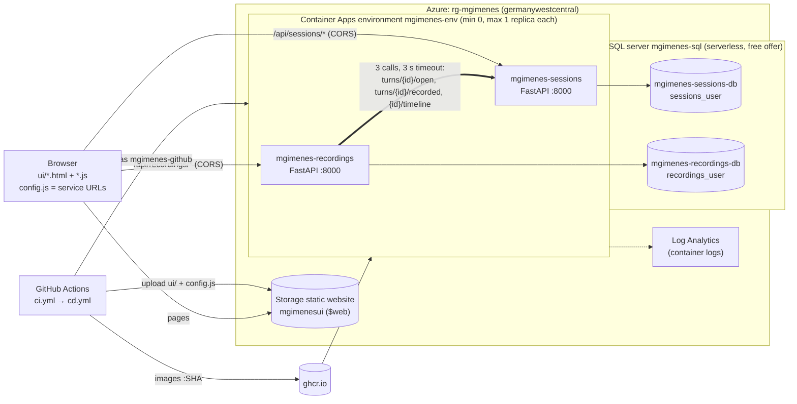
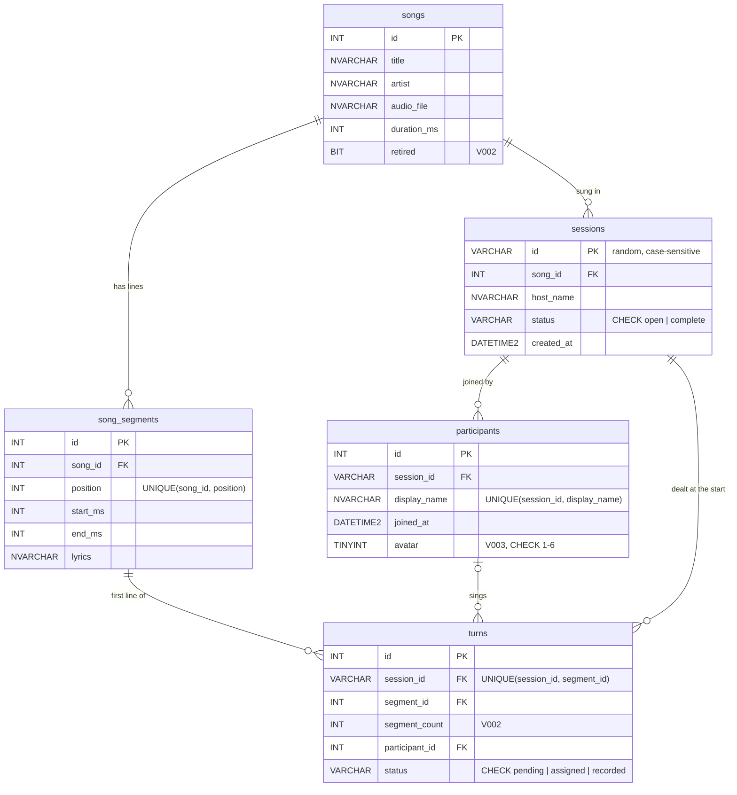

# Group Karaoke: Assignment 2 Report

Repository: https://github.com/matheusfunabashi/group-karaoke · Live UI: https://mgimenesui.z1.web.core.windows.net
Setup, configuration, API, tests and the Azure commands: `README.md`. Decisions: `ADR.md` (ADR-6 to ADR-12 are new). System description: `system.yaml`. AI usage: `AI_USAGE.md`. The Assignment 1 report is in the git history.

## 1. What changed since Assignment 1
Assignment 1 was one FastAPI process with two domains (sessions, recordings) sharing one SQLite file, with clips on disk. Assignment 2 splits it along the seam that ADR-2 and ADR-3 prepared:

| | Assignment 1 | Assignment 2 |
|---|---|---|
| Processes | one FastAPI app | two services, `services/sessions` and `services/recordings`, each with its own Dockerfile and image |
| Database | one SQLite file | one Azure SQL serverless database per service, reached only by that service's contained user |
| Schema | `CREATE TABLE IF NOT EXISTS` at startup | versioned migrations (sessions `V001` to `V003`, recordings `V001`, `V002`) recorded in `schema_migrations` (ADR-8) |
| Domain calls | Python function calls in `sessions_client.py` | HTTP calls in the same file, with a 3 s timeout and a 503 on failure (ADR-6, ADR-10) |
| Clips | files in `DATA_DIR/media` | `VARBINARY(MAX)` in the recordings table (ADR-7, migration V002) |
| UI | served by the app | static files on an Azure Storage static website, calling both services through CORS |
| Delivery | run by hand | CI on every branch, CD to Azure Container Apps on every push to `main` (ADR-9) |

The product changed too, after testing it with friends (ADR-11, ADR-12):
- **Short turns in rotation:** instead of each person claiming one long part, the host starts the session and the song's lines are dealt one each, in turn, so everyone sings the same number of short turns.
- **A karaoke screen:** the whole song plays, the current line fills in with the music, and the screen says "Sing now!" on your lines and "Not your part" on the others. Only your lines are recorded.
- **Exact timing:** music, lyrics, microphone and finale all run on one Web Audio clock, so clips line up with the music within milliseconds. The words fill in syllable by syllable, at the song's pace.
- **Audible voices:** the finale brings every voice up to the same loudness over a quieter backing track, because microphones record much quieter than a mastered song.
- **Characters:** each singer picks one of six original pixel-art characters. The session, recording and finale pages show a karaoke room with everyone around a table, and whoever has the current line stands up with the mic (migration V003).

The finale still plays every clip at its moment over the backing track.

## 2. SDLC model and how it went
**Model: iterative and incremental, one deployable step per increment.** Each step was built on a feature branch, checked by CI from the moment CI existed, and merged into `main` through a pull request with a merge commit (PRs #8 onwards). The order was chosen so the system kept working after every merge: containers first (11-10 to 11-16), then compose with SQL Server and the service split (11-17 to 11-19), then the move from SQLite to SQL Server (11-21), then Azure, CI/CD, the altering migration and the documentation (11-22). The deadline was then extended to 11-25, and the product changes above were built on 11-22 and 11-24, each one deployed and tested on the live site before the next.

**SMART goals for this assignment:**
1. Two services, each with its own Dockerfile and its own database, talking over HTTP through one client module. **Met** (`services/`, `sessions_client.py`).
2. At least 70% coverage per service, enforced by CI. **Met: sessions 99% (53 tests), recordings 99% (55 tests)**, and `--cov-fail-under=70` fails the build otherwise.
3. Every push to `main` deployed to Azure automatically, with a health check that proves the new version runs. **Met** (`cd.yml`; `/health` reports the git SHA and the database's migration).
4. A migration that alters a table holding data, with evidence on Azure. **Met** (recordings V002, `docs/evidence/v002-migration-on-azure.txt`; sessions V002 and V003 also altered tables that held data, and `/health` shows the version applied).
5. 12+ commits over 6+ days, no day above 40%, ADRs on 3+ dates, by the deadline. **Met: 38 commits on 10 days since 11-10, the busiest days 11-24 at 13 of 38 (34%) and 11-22 at 11 of 38 (29%); ADR-6 on 11-17, ADR-7 on 11-19, ADR-8 to 10 on 11-22, ADR-11 and 12 on 11-24.**

**Honestly:** the work was back-loaded. The Azure deployment, CI/CD, the altering migration and the documentation all landed on the last day, which is why that day is close to the 40% limit, and the README, this report and the AI log had to share one commit to stay under it. Two things went wrong and were fixed the same day: GitGuardian flagged a fake password inside a test URL (no real secret; the incident was marked a false positive and the test now builds the URL from parts), and the first V002 build failed in CI because pymssql sent byte strings that look like text as text (fixed by sending the audio as hex and converting it in SQL). Having CI run the tests against a real SQL Server is what caught the second one before it reached Azure.

## 3. Architecture

- **Inside each service** the layers from Assignment 1 are kept: `routes.py` (HTTP), `service.py` (rules), `repository.py` (SQL), plus `db.py` (connection with retries, transactions, migrations) and `config.py` (environment variables).
- **The seam:** recordings never touches the sessions database. It asks sessions three questions over HTTP, all in `sessions_client.py`: is this turn open, mark it recorded, give me the timeline. Sessions exposes exactly those three endpoints for it.
- **Configuration** is only environment variables (listed in `system.yaml`): `PORT`, `DATABASE_URL` (a Container Apps secret), `CORS_ORIGINS`, `APP_VERSION`, and `SESSIONS_URL` for recordings.

## 4. Data model
Two databases, so no foreign key can cross between them (ADR-3, ADR-6).

**mgimenes-sessions-db** (above): the same tables as in Assignment 1, now with SQL Server types, `CHECK` constraints on the statuses, and a binary collation on session ids so that `aB3x` and `ab3X` stay different sessions. V002 added `songs.retired` (a song whose lines change is added again and the old row retired, so old sessions keep their lines) and `turns.segment_count` (a turn can cover neighbouring lines); V003 added `participants.avatar`, the chosen character, giving people who had already joined characters in turn. All three ran on tables that already held data, so every new column has a default. `pending` turns only exist in sessions from before the rotation.

**mgimenes-recordings-db:** one table, `recordings (id, turn_id UNIQUE, session_id, file_name, content_type, size_bytes, created_at, audio VARBINARY(MAX) NULL)`, indexed on `session_id`. `turn_id` and `session_id` point at the other database by value only. `audio` was added by V002 on a table that already held a row on Azure; that row kept everything and has `audio = NULL`, which the finale shows as a part with no clip.

Both databases also have `schema_migrations (version, applied_at)`, written by the migration runner.

## 5. When things fail
| Failure | What the user gets | Where |
|---|---|---|
| Container scaled to zero and database paused (first request after an idle hour) | Up to about a minute of "The service is starting up after being idle, please wait..."; then it works | UI `api.js` retries 502/503/504 and network errors; `db.connect` retries with backoff (ADR-10) |
| Sessions down or slower than 3 s during an upload | 503 "...the clip was not saved, please try again"; nothing is half-saved | `sessions_client` raises `SessionsUnavailable`; the upload's transaction rolls back |
| Sessions down while opening the finale | 503 with a clear message; nothing else breaks | `routes.get_finale` |
| Database unreachable | `/health` answers 503 with `database.status = unavailable` | `db.database_status` |
| A deploy whose new version never becomes healthy | The CD run fails after about 5 minutes | `cd.yml` health step checks the SHA and the database |

## 6. Testing
- **Real database (ADR-4):** each test run creates a temporary SQL Server database, migrates it, empties the tables before every test and drops it at the end. In CI the server is a throwaway container whose password is generated during the run.
- **What is covered:** every business rule in both `service.py` files, the repositories against real constraints (`UNIQUE`, foreign keys, `CHECK`), the migration runner (including a test that builds a V001-only database with a row in it and then applies V002, as happened on Azure), connection retries, CORS, `/health` with the database down, the HTTP client to sessions (timeouts, refused connections, 5xx, 4xx), and the 503 when sessions is down.
- **Results (CI, 2026-11-24):** sessions 53 tests, 99%; recordings 55 tests, 99%. **Not covered:** the browser JavaScript (recording, playback, the room), which was tested by hand and in a browser driven by Claude Code: the timing was measured there (ADR-12), with a generated tone standing in for the microphone.

## 7. CI/CD and security
- **CI (`ci.yml`)** on every branch and PR: ruff lint, `system.yaml` against `system.schema.json`, both OpenAPI documents, the two test suites with coverage of at least 70%, and image builds.
- **CD (`cd.yml`)** on `main`: CI again (now pushing `ghcr.io/matheusfunabashi/group-karaoke-<service>:<SHA>` with `provenance: false`), OIDC sign-in to Azure, deploy both Container Apps, write `ui/config.js` and upload the UI, then wait for both `/health` endpoints to report the new SHA with the database ok.
- **No password in the repository or its history:** database passwords are generated by `infra/setup-sql.sh` and go straight into GitHub secrets, then into Container Apps secrets at deploy time; the SQL admin password is thrown away; the pipeline has no Azure secret at all (OIDC); `.env` is git-ignored.
- **Least privilege:** each service's database user has only `db_ddladmin`, `db_datareader` and `db_datawriter` on its own database; the pipeline's identity has Contributor on `rg-mgimenes` only; the SQL firewall only allows Azure services (the setup scripts open it to one IP and close it again); the storage account allows no public blob access apart from the static website.

## 8. Limitations and next steps
- Migrations run at container startup, which is safe only because each service has at most one replica. With more replicas they would need a lock (`sp_getapplock`) or a separate migration job.
- Every clip playback reads the bytes through the recordings service. With many listeners, a private Blob Storage container with short-lived links would be cheaper (ADR-7 alternatives).
- There are no accounts: a participant is remembered by the browser's `localStorage`, so anyone with a session link can join it.
- The browser code has no automated tests; Playwright tests for record-and-play would be the next step.
- Songs are timed per line, not per word, so the fill moves evenly through a line even when the words are sung unevenly.
- A singer must sing all their lines in one pass through the song; a failed line is sung again by going through the song again.

## 9. AI disclosure
I used **Claude Code (Anthropic)** throughout Assignment 2. My laptop ran out of disk space and I had to delete my IDE, so from 11-19 Claude Code made the file edits I asked for, while I reviewed, tested, committed and pushed every change myself. It helped plan the split into two services, move the code, switch from SQLite to SQL Server with migrations, write the CI/CD workflows, the Azure setup scripts, the OpenAPI files, `system.yaml`, the ADRs, the README and this report, and then build the line rotation, the karaoke screen, the Web Audio timing and the pixel-art characters. I made the product and design choices (the split, storing clips in the database, adding Payphone, short turns in rotation, playing the whole song with "Not your part", a karaoke room with six characters), reviewed the ADR wording, ran the scripts that create the database users and secrets so no password was ever shown or shared, and tested the result locally and on the live site. The dated log, with what I kept or changed, is in `AI_USAGE.md`.
