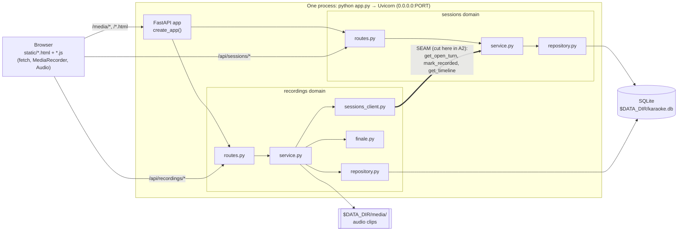
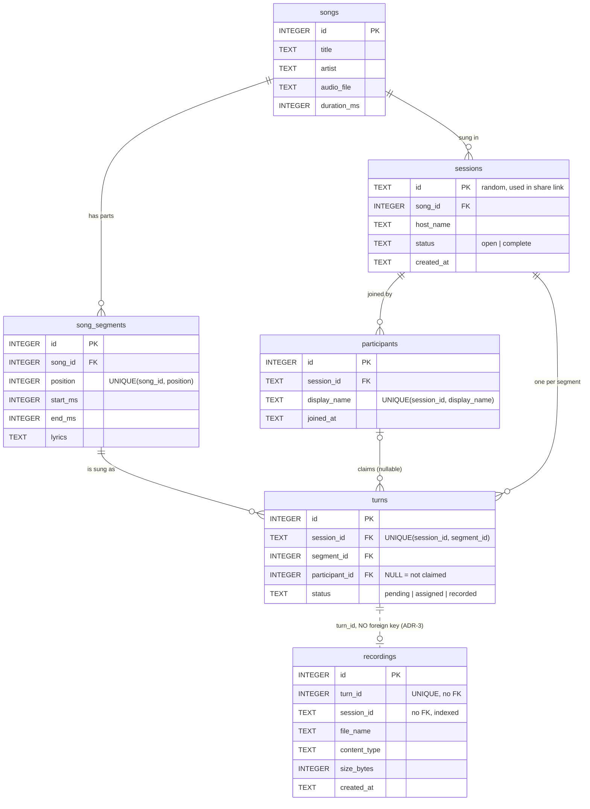

# Group Karaoke: Assignment 1 Report

Repository: https://github.com/matheusfunabashi/group-karaoke
Setup, configuration, API and test/coverage commands: see `README.md`. Design decisions: `ADR.md`. AI usage: `AI_USAGE.md`.

## 1. The application
Group Karaoke is asynchronous group karaoke. A host picks a song, which is split into segments; friends join through a shared link, each claims a segment and records their voice for it whenever they have time; a finale page plays every recorded clip at its segment's time over the backing track. It is one FastAPI process with SQLite storage, built so it can later be split into services and deployed to Azure (Assignment 2).

**Stakeholders (assumed):** friend groups and families who cannot sing together at the same time (different time zones, schedules); a host who organises the session; and, later, an operations team that will run it in containers. Assumed scale for the design: small groups (2–10 singers per session), a few hundred sessions per day, clips under 1 MB each.

## 2. SDLC model
**Chosen model: iterative and incremental (lightweight agile), one feature domain per increment.** Each increment was built on a feature branch, tested, and merged into `main` through a pull request, with an ADR written at the moment the decision was made.

**Why:** the brief rewards decisions made over time (ADRs over several dates, commits over several days). Building the sessions domain first and the recordings domain second meant each increment produced a working, tested slice, and the design could change based on what we learned; that is exactly what happened with the audio-only pivot (ADR-5). A waterfall plan would have fixed "video" in the requirements before we discovered its cost.

**SMART goals:**
1. *Specific/Measurable:* two feature domains (sessions, recordings) that both read and write SQLite, each with its own routes, service and repository. **Met.**
2. *Measurable:* at least 70% test coverage of core business logic with pytest-cov. **Met: 100% of the `karaoke` package (45 tests).**
3. *Achievable/Relevant:* satisfy all ten points of the deployment contract (§7): one command (`python app.py`), `0.0.0.0`, `PORT` and `DATA_DIR` env vars, no manual setup. **Met** (tested in `test_config.py`; tables are created on startup).
4. *Time-bound:* 5 ADRs over at least 3 dates and 12+ commits over 6 days before the deadline. **Partly met:** ADRs span 4 dates (10-06, 10-08, 10-11, 10-12) and there are 15+ descriptive commits, but they fall on only 4 calendar days.

**How we followed it in practice (honestly):** the increments and PR flow were followed (PRs #1–#7). The cadence was not: I did not commit on 10-07, 10-09 and 10-10, so work was compressed into 10-11 and 10-12 and the "6 distinct days" requirement was missed. I kept every commit's real date (no backdating). Two process problems also cost time: the project folder was in an iCloud-synced Desktop that offloaded files (including `.git`), so the repository was re-cloned to `~/code`; and the video feature was dropped mid-way (ADR-5), which was a good product decision but a late one.

## 3. Architecture overview

- **Layers per domain:** `routes.py` (HTTP only), `service.py` (business rules, no HTTP), `repository.py` (SQL only).
- **The seam between domains (ADR-2), marked SEAM in the diagram:** recordings never imports sessions code except in `recordings/sessions_client.py`. When the domains become separate services, only that file changes (function calls become HTTP calls) and the `recordings` table moves to its own database.
- **Front end:** plain HTML/CSS/JS served by the same process from `static/`; saved clips are served from `/media`.

## 4. Database model

Solid lines are real SQLite foreign keys inside the sessions domain (enforced with `PRAGMA foreign_keys = ON`). The **dotted line** from `turns` to `recordings` is a reference by id only: there is deliberately no foreign key across domains, as decided in **ADR-3**, so the recordings table can move to its own database later. The audio bytes are not in SQLite; only the file name is.

## 5. Testing
45 pytest tests, **100% coverage** (`pytest --cov=karaoke --cov-report=term-missing`). Each test uses a real SQLite file in a temporary folder; mocks are used only to simulate a failure mid-save. Details and what was left thinner (browser JavaScript) are in ADR-4.

## 6. AI disclosure
I used **Claude Code (Anthropic)** to understand the assignment, review my karaoke idea and set up the project. It helped write most of the code and tests, the architecture decisions, this report and the code explanations. I asked it to explain the brief, review the idea, start the project, switch to audio only and help with the finale playlist. I tried writing the playlist function first, then used its help to finish it. I reviewed the work, chose the product direction and studied how the code works. Codex later helped rewrite the AI usage log in simpler English and create the karaoke room background. The dated log is in `AI_USAGE.md`.
